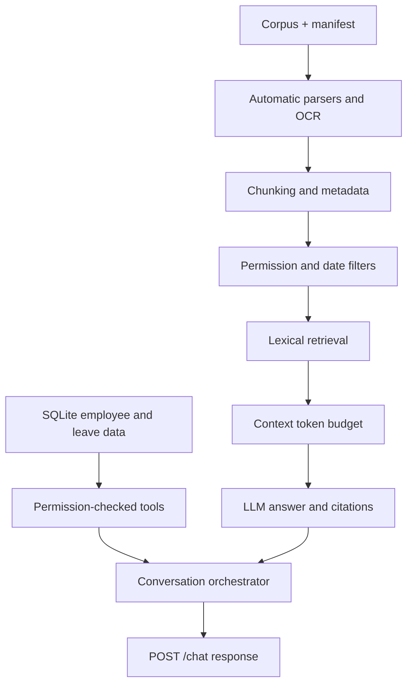

# Veltrix PeopleOps Assistant

A Python/FastAPI service that answers HR questions from the supplied corpus and accesses leave data through permission-checked tools.

## Run locally
1. Copy the supplied assessment files into `./data/` so the layout is `data/corpus/`, `data/manifest.json`, and `data/veltrix.db`.
2. Copy `.env.example` to `.env` and set `OPENAI_API_KEY`.
3. Run `docker compose up --build`.
4. Check `http://localhost:8000/health` and expect `{"status":"ok"}` after ingestion completes.

The service listens on port 8000. `POST /chat` expects `X-Employee-Id` and JSON with `session_id` and `message`.

## Architecture

## Assumptions
- The client sends one JSON object with `session_id` and `message`, as implied by the conversation contract.
- Policy reference date uses `APP_TODAY` when configured and otherwise the system date.
- OCR uses Tesseract when a PDF page has no text layer; the Docker image installs Tesseract.
- The source SQLite database is mounted read/write because leave tools must update balances and requests.
- The local lexical retriever is chosen to keep the vector store local and avoid requiring an embedding API. Replace with hybrid vector/lexical retrieval if needed after baseline evaluation.

## Sample queries
- What is the annual leave policy for my region?
- Which public holidays apply to me in 2026?
- What is my current annual leave balance?
- Apply for annual leave from 2026-11-10 to 2026-11-11.

## Known limitations
- Retrieval is lexical rather than semantic and should be upgraded if retrieval evaluation shows misses.
- Relative-date parsing and conflict resolution for natural-language policy questions need further hardening.
- Holiday extraction handles common date formats; validate all corpus calendar formats and add parsers for any uncovered patterns.
- The assessment should be tested against its modified corpus before submission.
